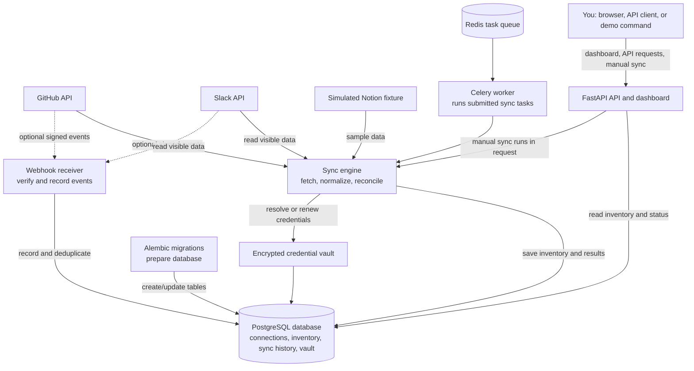

# AccessGraph Connect

AccessGraph Connect helps you answer a simple question: **who can access
what across our software tools?**

It collects information about people, resources, and permissions from
connected services and brings it into one common inventory. For example,
it can show GitHub repositories and their collaborators, or Slack channels
and their visible members. A dashboard shows connection health and recent
syncs.

The project is an **inventory and demonstration tool**, not a tool for
changing people's access. It does not remove users, revoke access grants,
read Slack messages, score risk, or make security decisions.

> **Important security limitation:** This project does not authenticate
> users or check whether a user is allowed to see a tenant. It trusts the
> tenant ID supplied in the request. The included Docker setup is for local
> use only; do not expose the API or dashboard to a network, or use it for
> multi-user or production workloads until authentication, tenant
> authorization, TLS, and production secret management are added.

## Contents

- [What the project does](#what-the-project-does)
- [Key terms](#key-terms)
- [Architecture](#architecture)
- [Run the local demo with Docker](#run-the-local-demo-with-docker)
- [Use the API](#use-the-api)
- [Connect GitHub](#connect-github)
- [Connect Slack](#connect-slack)
- [Configuration](#configuration)
- [Run without Docker](#run-without-docker)
- [How sync and connection health work](#how-sync-and-connection-health-work)
- [Security and limitations](#security-and-limitations)
- [Tests and troubleshooting](#tests-and-troubleshooting)
- [Project structure](#project-structure)

## What the project does

| Source | What it can discover | Important limitation |
| --- | --- | --- |
| GitHub | Repositories visible to an installed GitHub App, organization members when available, and repository collaborators and roles | Visibility depends on the installation, organization policies, and GitHub permissions. The origin of a permission may be unknown. |
| Slack | Workspace users, visible public and private channels, and available channel memberships | The app cannot see private channels it has not joined. It does not read messages or join channels itself. |
| Notion fixture | A built-in sample of users, pages, and access records | **Simulated data only**; this is not a live Notion integration. |

The data is translated into a shared format, stored in a database, and
shown through an API and a browser dashboard. A sync is a fresh collection
of information from one connection. The project keeps the source and
observation time with inventory records and labels simulated data on the
dashboard.

## Key terms

- **Tenant:** An organization or customer represented by a UUID. A demo
  tenant keeps its connections and inventory grouped together.
- **Connection:** An installed integration with a particular GitHub
  installation, Slack workspace, or the sample fixture.
- **Identity:** A person, bot, service account, or an account whose type is
  unknown.
- **Resource:** Something an identity can access, such as a repository,
  channel, workspace, or page.
- **Access record:** An observed relationship between an identity and a
  resource, including the permission or role reported by the provider.
- **Scope / permission:** What the integration is allowed to ask the
  provider for. This is different from the access an individual user has.
- **Sync:** A run that fetches, translates, and stores the latest visible
  data. A **partial** sync means some coverage is missing.
- **Stale:** A previously known record missing from a complete sync. It is
  marked as stale rather than deleted.

## Architecture



In everyday terms:

1. **Connectors** speak each provider's language and collect the data the
   installed app can see. The fixture connector reads sample data instead.
2. **Normalization** translates different provider responses into the same
   kinds of records: identities, applications, resources, and access.
3. **The sync engine** saves those records, avoids duplicates, records
   results, and checks whether old records should be marked stale.
4. **PostgreSQL** stores the inventory, connections, sync history, webhook
   inbox, and encrypted credential-vault entries. **Alembic** applies
   database schema changes before the Docker API and worker start.
5. **FastAPI** provides the HTTP API and serves the **dashboard**.
6. **Redis and Celery** provide a queue and worker for submitted background
   sync tasks. The provided Compose setup does **not** configure a recurring
   scheduler or enqueue syncs from webhooks. The manual sync endpoint runs
   synchronously in the API request.
7. **Webhook receivers** verify and deduplicate incoming GitHub and Slack
   events and record them; they do not currently update inventory or start
   a sync. Run a manual sync to refresh data.

### Technologies

Python, FastAPI, SQLAlchemy, Alembic, PostgreSQL, Redis, Celery, Jinja2,
Docker Compose, and pytest are used for the API, storage, background-task
infrastructure, dashboard, packaging, and tests.

## Run the local demo with Docker

This is the easiest way to explore the project. It uses simulated data, so
you do not need a GitHub App, Slack app, or provider credentials.

### Before you start

- Install and start [Docker Desktop](https://www.docker.com/products/docker-desktop/)
  (or Docker Engine with Docker Compose).
- Clone this repository and open a terminal in its root folder.
- Make sure port `8000` is available. The examples below use **PowerShell**
  on Windows; use the corresponding shell commands on other systems.

### 1. Prepare configuration and start services

If you do not already have a `.env` file, create one from the example. Do
not overwrite an existing `.env`: it may contain your own settings.

```powershell
if (-not (Test-Path .env)) { Copy-Item .env.example .env }
docker compose up --build -d
docker compose ps
```

The first build can take a few minutes. Compose starts the database and
Redis, applies migrations, and then starts the API and worker. Database
data is kept in a named Docker volume across normal restarts.

### 2. Add the sample data

```powershell
docker compose run --rm api python -m app.demo
```

The command prints the tenant ID, connection ID, sync status, and a
dashboard URL. Open the printed URL in your browser. The dashboard should
say **Simulated data**. The fixture can report `partial` because it includes
an unknown permission origin; this is an expected coverage limitation.

Run the same command again to refresh the same demo tenant and connection
without duplicating the inventory. To use an **existing** tenant instead:

```powershell
docker compose run --rm api python -m app.demo --tenant-id '<TENANT_UUID>'
```

Replace `<TENANT_UUID>` with an existing tenant ID, without the angle
brackets. The command does not create an arbitrary tenant supplied this way.

### 3. Check that it is running

- API health: <http://127.0.0.1:8000/healthz>
- Database readiness: <http://127.0.0.1:8000/readyz>
- Interactive API documentation: <http://127.0.0.1:8000/docs>
- Dashboard: use the URL printed by the demo command.

Health checks that the API is responding; readiness also checks its database
connection. They do not prove that a live provider is connected.

### Stop and restart

```powershell
docker compose stop       # Stop services; keep containers and data
docker compose start      # Start stopped services again
docker compose logs api   # View API logs
```

`docker compose down` removes the containers but normally preserves the
database volume. **Do not add `--volumes` unless you intend to delete the
stored demo database.** If configuration or source code changes, use
`docker compose up --build -d` to rebuild/recreate the services.

## Use the API

The easiest way to explore all endpoints is the interactive documentation
at <http://127.0.0.1:8000/docs>. For tenant-scoped endpoints, provide the
same `X-Tenant-ID` UUID printed by the demo or used during installation.
The dashboard uses `tenant_id` in its URL instead. This ID selects data;
**it is not a password or an access-control mechanism**.

Here is a PowerShell example. Replace the sample UUID with the one printed
by the demo:

```powershell
$tenantId = '00000000-0000-0000-0000-000000000000'
$headers = @{ 'X-Tenant-ID' = $tenantId }

Invoke-RestMethod -Uri 'http://127.0.0.1:8000/connections' -Headers $headers
Invoke-RestMethod -Uri 'http://127.0.0.1:8000/inventory/identities' -Headers $headers
Invoke-RestMethod -Uri 'http://127.0.0.1:8000/inventory/resources' -Headers $headers
Invoke-RestMethod -Uri 'http://127.0.0.1:8000/inventory/access' -Headers $headers
Invoke-RestMethod -Uri 'http://127.0.0.1:8000/sync-runs' -Headers $headers
```

To refresh a connection, use its `id` from `/connections`:

```powershell
$connectionId = '<CONNECTION_UUID>' # Replace with the actual ID
Invoke-RestMethod -Method Post `
  -Uri "http://127.0.0.1:8000/sync/$connectionId" -Headers $headers
```

| Endpoint | Purpose |
| --- | --- |
| `GET /healthz`, `GET /readyz` | API health and database readiness |
| `GET /dashboard?tenant_id=<UUID>` | Browser view of a tenant's inventory and operations |
| `GET /connections` | Connected providers, IDs, scopes, and connection status |
| `POST /connections/github/start`, `GET /connections/github/callback` | Start and complete GitHub App installation |
| `POST /connections/slack/start`, `GET /connections/slack/callback` | Start and complete Slack app installation |
| `POST /sync/{connection_id}`, `GET /sync-runs` | Run a manual sync and inspect its history |
| `GET /inventory/identities`, `/inventory/resources`, `/inventory/access` | Read the tenant's normalized inventory |
| `POST /webhooks/github`, `POST /webhooks/slack` | Verify and record provider events; do not trigger syncs |

The dashboard also counts applications. There is currently no separate
applications inventory endpoint. The sync result contains a coverage-note
**count**; detailed coverage-note text is not currently exposed in the API.

## Connect GitHub

Use a test organization and repositories first. You need permission to
create and install a GitHub App in that organization.

1. Create a **GitHub App**, not a personal access token. Configure its
   setup URL to reach `/connections/github/callback` on this service after
   installation. Use an address your browser can reach; if using a public
   endpoint, follow the restricted-exposure warning below.
2. Grant the read permissions needed for the data you want to discover,
   including organization **Members: read**, and select the repositories
   the installation should see. Repository collaborator visibility has
   additional [GitHub endpoint requirements](https://docs.github.com/en/rest/collaborators/collaborators#list-repository-collaborators).
   Insufficient permissions or organization policies can produce partial
   coverage; do not grant write access merely to hide that limitation.
3. Generate an app private key in GitHub. Put the app ID, app slug, private
   key, a signing key, and a Fernet encryption key in your local `.env`, as
   described in [Configuration](#configuration). Store the PEM key as one
   line with literal `\n` sequences between its lines. Restart/recreate the
   API and worker after changing the file.
4. Choose a tenant UUID. You can use the demo tenant ID, or create one
   locally with `[guid]::NewGuid().ToString()` in PowerShell. Use that same
   ID for the installation and later API calls.
5. Start installation and open the returned `install_url`:

   ```powershell
   $tenantId = '<TENANT_UUID>'
   $headers = @{ 'X-Tenant-ID' = $tenantId }
   $result = Invoke-RestMethod -Method Post `
     -Uri 'http://127.0.0.1:8000/connections/github/start' -Headers $headers
   $result.install_url
   ```

6. Install the app and complete the redirect. The callback validates the
   signed state, exchanges an installation token, and stores it encrypted.
   The callback creates the tenant if it does not already exist. List
   `/connections`, then run a manual sync using the returned connection ID.

GitHub installation tokens are short-lived. Before a sync, the project
renews a token if its expiry is missing or within five minutes, and
replaces the local encrypted vault reference.

## Connect Slack

A **free Slack workspace** is sufficient for trying the integration;
available data and app approval policies still depend on the workspace.

1. Create a Slack app in a test workspace and add these bot token scopes:
   `users:read`, `users:read.email`, `channels:read`, and `groups:read`.
2. Configure an **HTTPS** redirect URL ending in
   `/connections/slack/callback` in the Slack app's OAuth settings. Set the
   identical URL as `SLACK_REDIRECT_URI` in `.env`. Plain HTTP localhost
   is not sufficient for Slack OAuth; the included Compose demo is HTTP
   only.
3. Set `SLACK_CLIENT_ID`, `SLACK_CLIENT_SECRET`, `SLACK_SIGNING_SECRET`,
   `SECRET_KEY`, and `TOKEN_ENCRYPTION_KEY` in `.env`; then recreate the
   API and worker. The signing secret is needed for Slack webhooks.
4. Choose a tenant UUID as described in the GitHub section. Run:

   ```powershell
   $tenantId = '<TENANT_UUID>'
   $headers = @{ 'X-Tenant-ID' = $tenantId }
   $result = Invoke-RestMethod -Method Post `
     -Uri 'http://127.0.0.1:8000/connections/slack/start' -Headers $headers
   $result.authorize_url
   ```

5. Open the returned URL, approve the app, and complete the redirect. The
   callback creates the tenant if needed and stores the bot token encrypted.
   List `/connections` and run a manual sync for the new connection.

The Slack sync reports a visibility limitation for private channels and
therefore remains partial. If you enable Slack Events, configure an HTTPS
request URL ending in `/webhooks/slack`; verified events are recorded but
do not automatically update inventory.

**Public callback warning:** The API has no authentication. If a local
HTTPS proxy or tunnel is necessary, restrict public access to only the
required OAuth callback and, optionally, webhook routes. Do not expose the
entire API or dashboard. A tunnel provider can see requests it forwards;
only use one you trust and understand its privacy implications.

## Configuration

Copy [`.env.example`](.env.example) to `.env` for local settings. Never
commit `.env`, private keys, provider secrets, or tokens. The sample values
are for local development and are not production credentials.

| Setting | Meaning |
| --- | --- |
| `ENVIRONMENT` | Runtime environment. Production mode validates the signing and encryption keys. Compose explicitly uses `demo`. |
| `DATABASE_URL` | Database connection for a locally run Python app. Compose supplies its own PostgreSQL address. |
| `REDIS_URL` | Redis address for locally run Celery tasks. Compose supplies its own Redis address. |
| `SECRET_KEY` | Signs short-lived OAuth state. Use a unique random value, especially for live integrations. |
| `TOKEN_ENCRYPTION_KEY` | Fernet key used to encrypt provider tokens. Required for live GitHub and Slack connections; not required for the fixture demo. |
| `GITHUB_APP_ID`, `GITHUB_APP_SLUG`, `GITHUB_APP_PRIVATE_KEY` | GitHub App identity, installation URL name, and PEM private key. |
| `GITHUB_WEBHOOK_SECRET` | Secret for verifying GitHub webhook signatures, if webhooks are configured. |
| `GITHUB_API_BASE`, `GITHUB_WEB_BASE` | GitHub API and website addresses; normally leave the example defaults. |
| `SLACK_CLIENT_ID`, `SLACK_CLIENT_SECRET` | Slack app credentials used during OAuth installation. |
| `SLACK_SIGNING_SECRET` | Verifies Slack webhook signatures. |
| `SLACK_REDIRECT_URI` | The exact HTTPS OAuth redirect registered in Slack. |
| `SLACK_API_BASE` | Slack API address; normally leave the example default. |

Generate keys locally after installing the Python dependencies, then copy
the outputs into `.env`. Keep them private and do not post them in chat:

```powershell
python -c "import secrets; print(secrets.token_urlsafe(32))"
python -c "from cryptography.fernet import Fernet; print(Fernet.generate_key().decode())"
```

The first output is for `SECRET_KEY`; the second is for
`TOKEN_ENCRYPTION_KEY`. If you only have Docker, after building the demo
image you can generate them inside it instead:

```powershell
docker compose run --rm api python -c "import secrets; print(secrets.token_urlsafe(32))"
docker compose run --rm api python -c "from cryptography.fernet import Fernet; print(Fernet.generate_key().decode())"
```

Changing the encryption key without a key-rotation process makes existing
vault entries unreadable; retain the key securely. Production-mode key
validation alone does **not** make this application production-ready.

## Run without Docker

For development, Python **3.12 or newer** is required. The following
PowerShell example uses SQLite for a simple local demo. It does not need
Redis for manual syncs. SQLite is also used by the tests; PostgreSQL is used
by the Compose stack.

```powershell
python -m venv .venv
.\.venv\Scripts\Activate.ps1
python -m pip install -e ".[dev]"
$env:DATABASE_URL = 'sqlite:///./local.db'
python -m alembic upgrade head
python -m app.demo
python -m uvicorn app.main:app --reload
```

Open the dashboard URL printed by the demo once the server starts. Keep
the terminal running for the server; press `Ctrl+C` to stop it. Environment
variables set with `$env:` apply only to that PowerShell session. For
another terminal, activate the virtual environment and set `DATABASE_URL`
again before running database commands.

Running a background Celery worker separately requires a reachable Redis
server and a matching `REDIS_URL`:

```powershell
python -m celery -A app.sync.celery_app:celery_app worker --loglevel=info --pool=solo
```

The `solo` pool is suitable for local development on Windows. The worker
does not itself schedule recurring jobs. Use Docker Compose for the
ready-made API/worker/database/Redis setup.

## How sync and connection health work

1. A manual request, the demo command, or an explicitly submitted Celery
   task starts a sync for one connection.
2. The connector fetches the provider data it can access. Fetches use
   bounded retries for retryable failures.
3. Provider-specific data is converted into the common inventory format
   and saved. Repeating a sync updates matching records rather than adding
   duplicates.
4. If the snapshot is complete, previously known missing records are
   marked stale. If the sync is partial or fails, known records are not
   marked stale just because they were missing from that run.
5. The result is recorded in sync history, and the dashboard displays
   connection health and data provenance.

| Status | Meaning |
| --- | --- |
| `succeeded` | Sync completed without reported coverage gaps. |
| `partial` | Some data may be missing or uncertain; existing data is not reconciled away. |
| `failed` | The sync could not complete; check the error code and detail in `/sync-runs`. |
| `active` | Connection health after a complete sync or successful authorization. |
| `degraded` | A partial sync or transient/provider failure needs attention. |
| `reconnect_required` | Credentials are missing, unreadable, or rejected; reauthorize the connection. |

Unknown is intentional: if a provider does not reveal whether access is
direct or inherited, the project does not guess. Records retain their
source and observation time; the dashboard distinguishes live, simulated,
mixed, and not-yet-synced data.

## Security and limitations

- The API and dashboard do **not** provide login or tenant authorization.
  `X-Tenant-ID` and the dashboard's tenant ID merely select data.
- Compose binds the API to `127.0.0.1` and is a local demo, not a secure
  production deployment. Never expose the full API through a tunnel.
- Provider tokens are encrypted in the database-backed vault. Connections
  store a reference instead of the token, and API responses exclude it.
- Replacing a credential locally revokes its old **vault reference**, not
  the token at GitHub or Slack. Provider-side revocation is a deliberate
  operator action. Slack's
  [`auth.revoke`](https://docs.slack.dev/reference/methods/auth.revoke/)
  can deactivate the bot and remove its channel memberships.
- Webhook signatures are checked and duplicate deliveries recorded once,
  but webhook events do not currently cause inventory syncs. There is no
  recurring schedule configured in Compose.
- Inventory is only as complete as provider visibility and permissions.
  Slack private channels and GitHub collaborator visibility can be limited.
  Data may be stale until a sync is run.
- Notion is fixture-only. AI agents, risk scoring, graph reasoning,
  approvals, access removal, suspension, and automatic remediation are
  outside the project's current scope.

## Tests and troubleshooting

Run the test suite from the repository root after installing the development
dependencies:

```powershell
python -m pytest -q
```

Tests use a temporary SQLite database and apply migrations. The
[Compose demo workflow](.github/workflows/compose-demo.yml) also builds the
stack, checks health and readiness, runs the fixture seeder twice, and
checks the dashboard's simulated-data label.

| Problem | What to check |
| --- | --- |
| Docker command fails or services are stopped | Start Docker Desktop, then run `docker compose ps` and `docker compose logs api`. |
| Port 8000 is in use | Stop the conflicting local service or change the loopback port mapping in your local Compose configuration. |
| `/readyz` is unavailable | Check that the database and migration service started successfully with `docker compose ps -a` and `docker compose logs migrate`. |
| Dashboard is empty | Run the demo seeder and open its printed URL; check that the tenant ID matches your API header. |
| Live installation fails | Check provider app credentials, exact callback URL, encryption key, and provider permissions. Restart services after updating `.env`. |
| Sync is partial | Check provider visibility and permissions. Slack's private-channel visibility limitation is expected; the API currently exposes the number of coverage notes, not their text. |
| Sync says `reconnect_required` | Check token encryption configuration and reauthorize the provider. Do not replace an existing encryption key casually. |
| Slack callback does not work | Confirm Slack's registered redirect and `SLACK_REDIRECT_URI` match exactly and use HTTPS. Keep any public proxy restricted to the required routes. |

## Project structure

```text
app/
  api/             HTTP routes, request dependencies, and response schemas
  connectors/      GitHub, Slack, and simulated Notion provider adapters
  normalization/  Translation into shared inventory records
  sync/            Sync engine, retry, persistence, reconciliation, Celery
  security/        OAuth state, encrypted credentials, webhook verification
  db/              Database models, sessions, and Alembic migrations
  dashboard/       Server-rendered browser dashboard
  demo.py          Repeatable simulated-data setup
  config.py        Environment settings and production-key checks
  main.py          FastAPI application
tests/              Automated tests and sample provider payloads
docs/               Additional architecture and design documentation
docker-compose.yml  Local PostgreSQL, Redis, migration, API, and worker setup
```

For more engineering detail, see [architecture](docs/architecture.md) and
[design decisions](docs/design-decisions.md).
